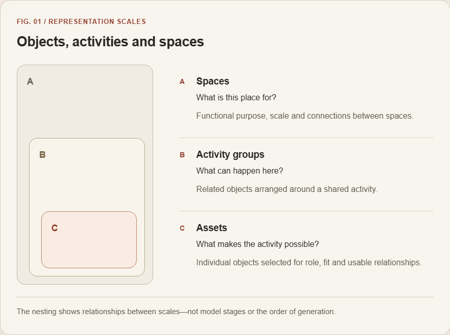

[English](README.md) | [简体中文](README.zh-CN.md)

# AIWG: AI World Generator

[Project page](https://ruixiaozhang.com/index_EN#work-aiwg)

A room is more than a collection of plausible objects. Its purpose depends on what people can do there, how objects work together, and whether there is room to move and use them. AIWG explores these relationships across assets, activity groups and spaces.

The nesting shows relationships between scales—not model stages or the order of generation.

The current prototype combines learned asset features with explicit rules. Learned models for activity groups and spaces remain experimental; this is not an end-to-end learned system.

## From similarity to usable space

Embeddings describe aspects of similarity and context. They can help choose related objects, but similarity alone cannot establish access, physical fit or usability. The current hospital prototype combines learned asset features with explicit spatial and interaction rules, followed by inspection and revision in Unreal Engine.

## Reusable construction

AIWG is also exploring reusable geometry and material construction, so scene variety can extend beyond selecting items from a fixed asset collection. The direction connects spatial understanding, functional allocation, model construction and placement dependencies across objects, activity groups and rooms. Current prototypes still require geometric and material inspection; this is a development direction, not a demonstrated universal scene generator.

## My work and current limits

I develop the research concept, interaction design and prototype workflow. The three scales organise the problem; they are not three validated learned models. Higher-level learning remains experimental, and its benefit over simple baselines has not been established.

## Work in progress

The work and manuscript are in progress. These scene images show the setting and visual development, not proof of complete interaction reliability or research effectiveness. This page shares the approach and its limits, without training details, experimental figures or player-study results.

Since October the prototype has been extended from the hospital to a second setting, a commercial kitchen. The kitchen is built from reusable parametric parts with full material maps, and is used to test whether the same construction and checking workflow carries over to a different kind of space. Its interaction checks are scripted samples; it has not been reviewed in free play.

## Inside the hospital prototype

### Corridor and circulation

Development scene from the hospital prototype, shown as a lighting study—not evidence of completed interaction tasks.

### A connected multi-storey setting

Development scene from the hospital prototype, shown as a lighting study—not evidence of completed interaction tasks.

### A room organised around use

Development scene from the hospital prototype, shown as a lighting study—not evidence of completed interaction tasks.

## Inside the kitchen prototype

### A kitchen organised by work stations

Development scene from the commercial kitchen prototype, an entrance overview—not evidence of completed interaction tasks.

## Related pages

[AINPC](https://github.com/Shawn200212/Author-Constrained-AINPC)

[Disclosure](DISCLOSURE.md) · [Image inventory](docs/public-media.json) · [Rights and credits](RIGHTS_AND_CREDITS.md)

Overview updated 28 October 2026. Existing concepts and the hospital images correspond to the earlier project website overview. The kitchen paragraph and image were added here; the website was not synchronized in this update. This repository is a research overview, not a runnable project or a complete research artifact.
